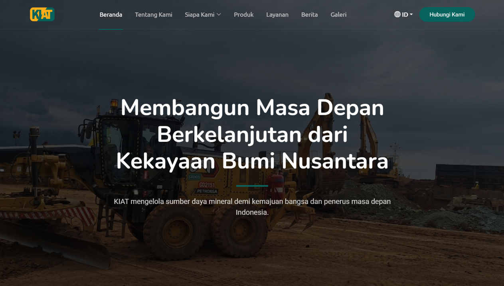

This web application was developed for PT Kawasan Industri ANTAM Timur (PT KIAT), a strategic subsidiary of PT ANTAM Tbk positioned as its nickel ore trading arm.

## About KIAT

")
{style="width:50%;"}

PT Kawasan Industri ANTAM Timur (PT KIAT) is a strategic subsidiary of PT ANTAM Tbk, positioned as its nickel ore trading arm. The company was established to help optimize the national nickel ore supply chain in line with the government's downstreaming policy and the business transformation direction of MIND ID Group and ANTAM Group.

Headquartered in Jakarta, PT Kawasan Industri ANTAM Timur (PT KIAT) was established on April 20, 2015. The company focuses on PT ANTAM's trading arm activities, with PT ANTAM Tbk holding a 99.80% stake and International Mineral Capital holding 0.20%.

PT KIAT serves as a commercial and operational entity connecting nickel ore supplies from IUP holders with smelter demand through transparent, efficient, and compliant trading mechanisms. In this role, PT KIAT acts as the centralized nickel ore trading arm for MIND ID Group and ANTAM Group, aggregates nickel ore supply and demand, and enables logistics and commercial arrangements (FOB / CIF).

## Development Phase

The project began when PT KIAT contacted us to create a company profile website. After a series of discussions, we agreed to build the website using the CodeIgniter 4 framework and the approved design.

During development, our team consisted of two people: Muhammad Daffa Rakan, Web Designer and UI/UX Consultant, and Azriel Fidzlie (myself), Web Developer. We completed the website development in approximately one month.


Visit KIAT 


We continued refining the application through revisions, feature additions, and bug fixes until it became a complete, ready-to-use platform. The project then moved on to its next phase.

## Ongoing Maintenance

In this phase, we provide ongoing maintenance for the PT KIAT company profile website. This includes content updates, bug fixes, and website performance improvements. We also regularly [monitor](https://status.azriel.id/history/kiat) the website to ensure it continues to run optimally and remains protected from potential security threats.
