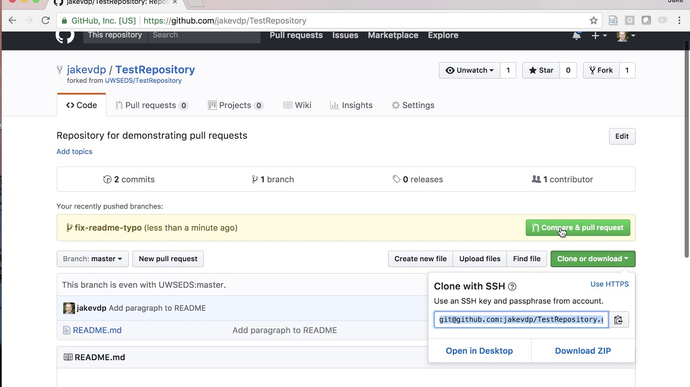
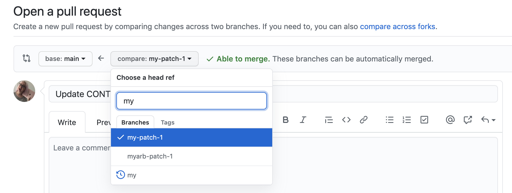
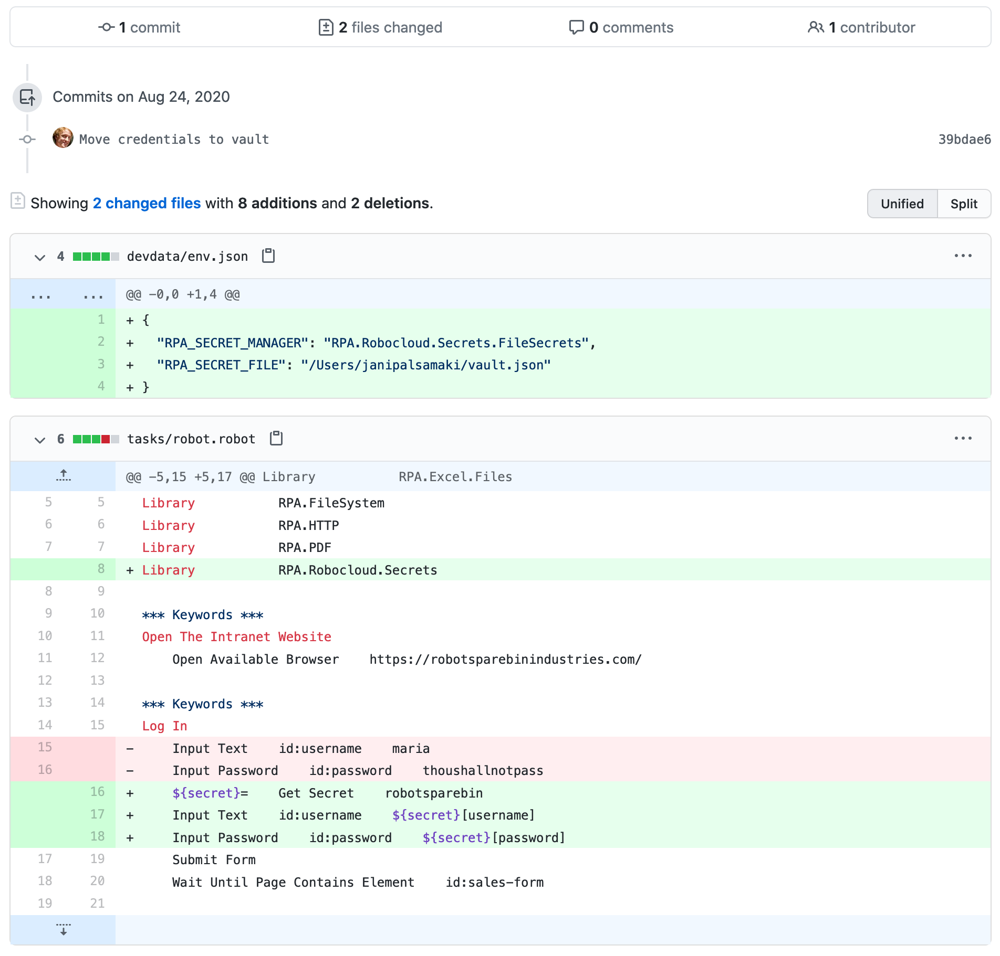

## Background

We may have worked alone on personal projects too often. Here, I will show you how to contribute to other people’s projects. The easiest way to do that is by finding an open source project. An open source software project is one that provides its source code to users freely, and often the development is done openly. Anyone can contribute by writing code for it.

Using open source software is definitely a good thing, because besides avoiding piracy, we also support the developers of the software we use. However, it would be even better if we also contributed, starting from usage contributions, bug reports, all the way to code contributions. Contributing to open source projects will help us improve our software development skills.

## How

Here are the steps briefly:

1. Fork it!
2. Create a new feature _branch_: `git checkout -b my-new-feature`
3. _Commit_ the changes: `git commit -am 'Add some features'`
4. _Push_ to the branch on the _remote_: `git push origin my-new-feature`
5. Create a _pull request_

6. Find an open source project.  
   _This time, as an Android developer, I will use_ **[Material Tabs](https://github.com/neokree/MaterialTabs)** _as an example._
7. Look for information about contribution rules, or contact the related developer via email or social media.
8. If no contribution rules are listed and the developer does not respond, you can directly fork the project you want to contribute to.
9. After forking is complete, the repository will be added to your list of repositories.

## Time to GO CODE ;)

NB: use `git --help` to see other Git commands.

1.  Clone the project that you already forked to your account.

        git clone <repo-address>

    Example:

        git clone git@github.com:CreatorB/MaterialTabs.git

2.  To make development easier, we should add the central repository to our local one to avoid conflicts with other contributors.

        git remote add <repo-name> <repo-address>

    Example:

        git remote add upstream git://github.com/neokree/MaterialTabs.git

3.  After the remote repository is set up, create a new branch so as not to break the main branch history and to make code tracking easier.

        git checkout -b <branch-name>

    Example:

        git checkout -b sample-project

4.  This new branch is where we will make code changes, which can later be pushed to the central repo. To switch branches, we can use `git checkout <branch-name>`, where `<branch-name>` is the name you used in the previous step.

5.  After making changes, we can commit them with a short description of what we changed. However, if we add files, we can use `git add <new-file-name>`, or use `git add .` to add all changes in that directory recursively. Only after that can we commit.

        git commit -m "<short message>"

    Example:

        git commit -m "fix sample project and added gradle compile"

6.  After completing the commit, we prepare to create a _pull request_ (usually abbreviated as PR) to the central repo. First, switch the branch back to master.

        git checkout master

7.  After that, we pull the latest code from the central repo to ensure there are no conflicts in our contribution. Conflicts can occur if two or more contributors make changes to the same file, especially if they edit the same lines, regardless of whether the intended changes are the same or different.

        git fetch upstream
        git merge upstream/master

8.  With this process, we can at least ensure that there are no conflicts with the central repo. Now we return to our local development branch, `sample-project`.

        git checkout sample-project

9.  After that, we merge that branch with the main branch so the contribution can be sent back to the central repository owned by neokree, the Material Tabs Android library, using the command `git rebase <branch-name>`.

        git rebase master

10. Before pushing to the central repository owned by neokree, we will push it to the forked repository from the beginning of this discussion.

        git push origin sample-project

11. After pushing, we will create a pull request and compare the changes we made against the central repo. You can also include a message to inform the repository owner about what you did. Once you are confident with the changes, select “Create pull request” and wait for a response from the repo owner. You can see more details in the screenshot section.

## Screenshot

Note: All uploaded images have been adjusted to match the latest GitHub interface. The source for all images comes from various YouTube videos and is not personal property.

Change the master branch to the branch you created (sample-project) and choose pull request / new pull request.

After that, you will go to the pull request confirmation page, where you can compare code between branches and add comments.

After creating the pull request, you will be taken to the request page for the project you submitted.

