## Pengertian Git

Git adalah sebuah version control system yang digunakan oleh para developer untuk mengembangkan software secara bersamaan. Fungsi utama dari Git adalah mengatur versi source code program dengan memberikan tanda baris serta code mana yang perlu ditambah ataupun diganti.

## Download Git

Silahkan buka website resminya Git [git-scm.com](https://git-scm.com/). Kemudian unduh Git sesuai dengan arsitektur komputer kita. Kalau menggunakan 64bit, unduh yang 64bit. Begitu juga kalau menggunakan 32bit.

## Langkah-langkah Install Git di Windows

Baiklah, mari kita mulai ritual instalnya. Silahkan klik 2x file instaler Git yang sudah diunduh.

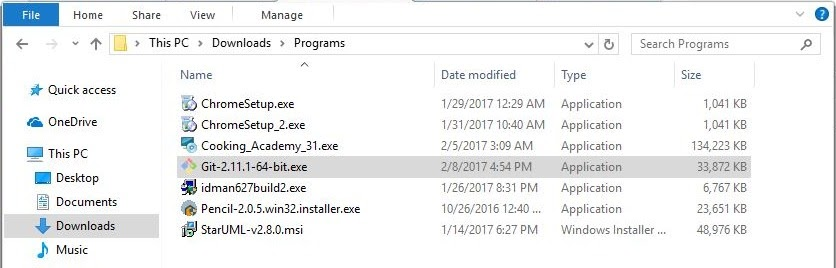

Maka akan muncul infomasi lisensi Git, klik `Next >` untuk melanjutkan.

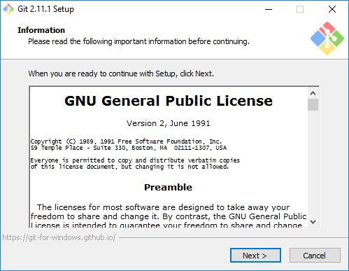

Selanjutnya menentukan lokasi instalasi. Biarkan saja apa adanya, kemudian klik `Next >`.

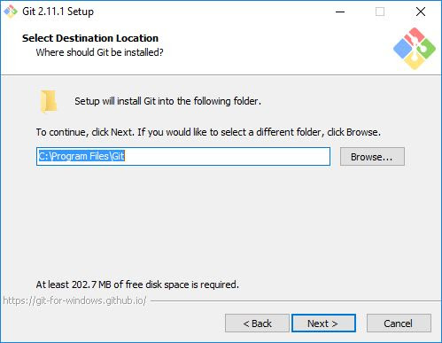

Selanjutnya pemilihan komoponen, biarkan saja seperti ini kemudian klik `Next >`.

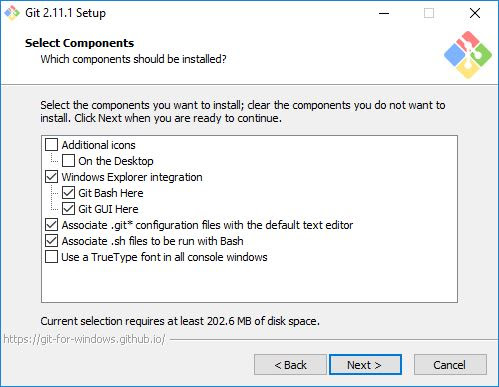

Selanjutnya pemlilihan direktori start menu, klik `Next >`.

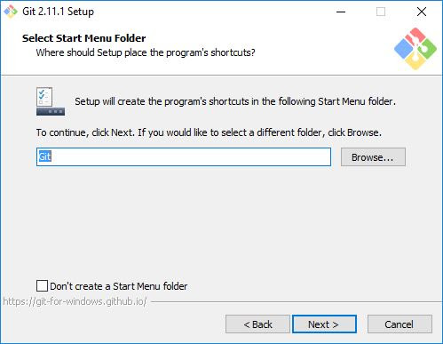

Selanjutnya pengaturan PATH Environment. Pilih yang tengah agar perintah `git` dapat di kenali di Command Prompt (CMD). Setelah itu klik `Next >`.

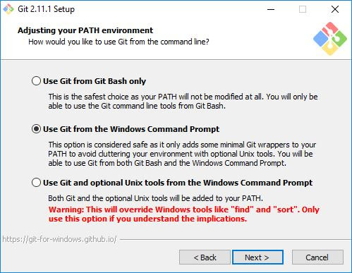

Selanjutnya konversi line ending. Biarkan saja seperti ini, kemudian klik `Next >`.

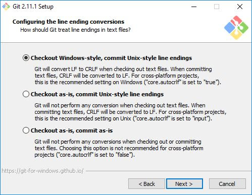

Selanjutnya pemilihan emulator terminal. Pilih saja yang bawah, kemudian klik `Next >`.

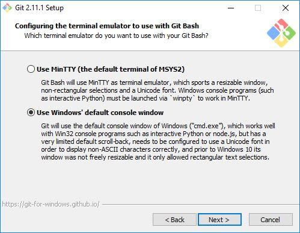

Selanjutnya pemilihan opsi ekstra. Klik saja `Next >`.

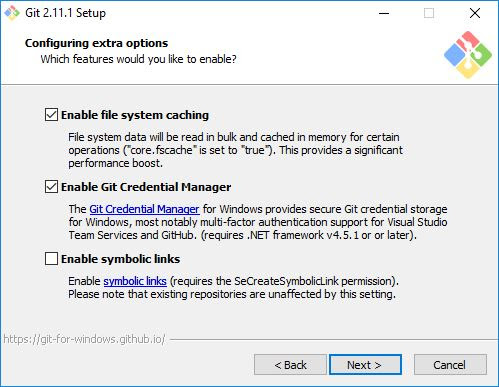

Selanjutnya pemilihan opsi ekspreimental, langsung saja klik `Install` untuk memaulai instalasi.

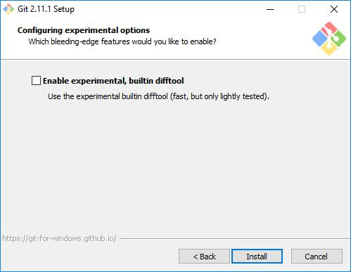

Tunggu beberapa saat, instalasi sedang dilakukan.

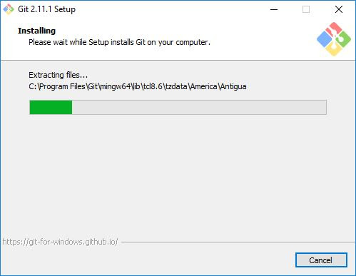

Setelah selesai, kita bisa langsung klik `Finish`.

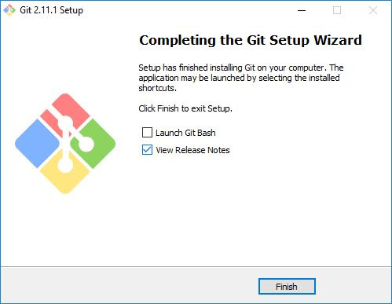

Selamat, Git sudah terinstal di Windows. Untuk mencobanya, silahkan buka CMD atau PowerShell, kemudian ketik perintah `git --version`.

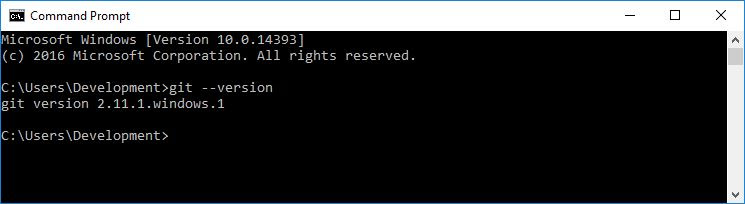

## Konfigurasi Awal yang Harus Dilakukan

Ada beberapa konfigurasi yang harus dilakukan sebelum mulai menggunakan Git, seperti menentukan name dan email.

Silahkan lakukan konfigurasi dengan perintah berikut ini.

```bash
git config --global user.name "Nama Anda"
git config --global user.email "Email Anda"
```

contoh:

```bash
git config --global user.name "0zunu"
git config --global user.email "fidzlieazriel@gmail.com"
```

Kemudian periksa konfigurasinya dengan perintah:

```bash
git config --list
```

Apabila berhasil tampil seperti gambar berikut ini, berarti konfigurasi berhasil.

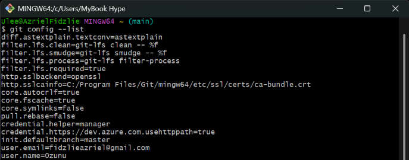

Konfigurasi `core.editor` bersifat opsional. Sedangkan name dan email wajib.

Jika kamu memiliki akun Github, Gitlab, Bitbucket atau yang lainnya…

maka username dan email harus mengikuti akun tersebut agar mudah diintegrasikan.
