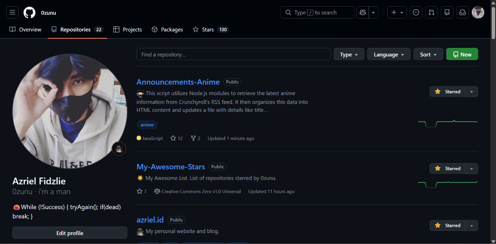
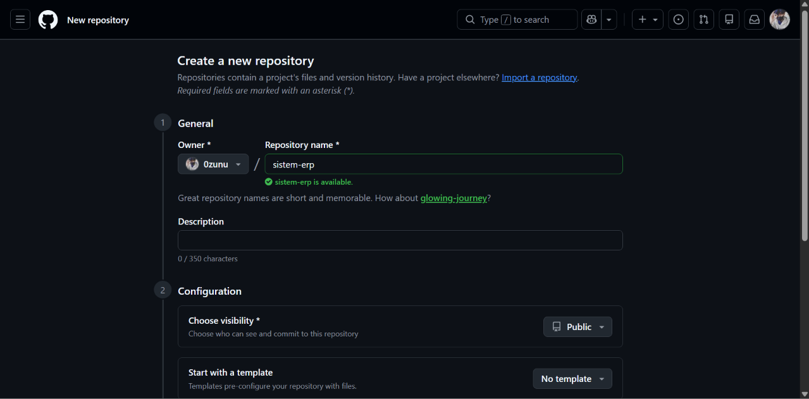
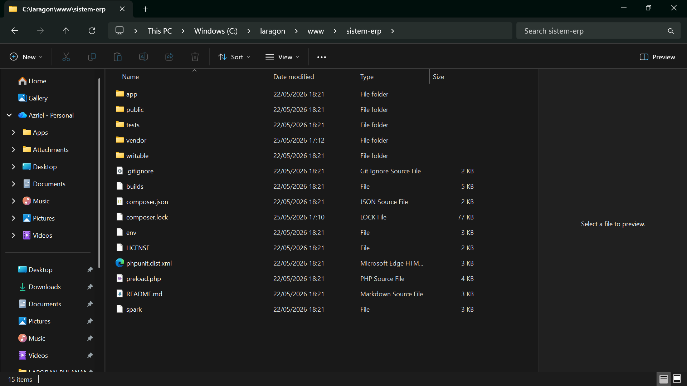
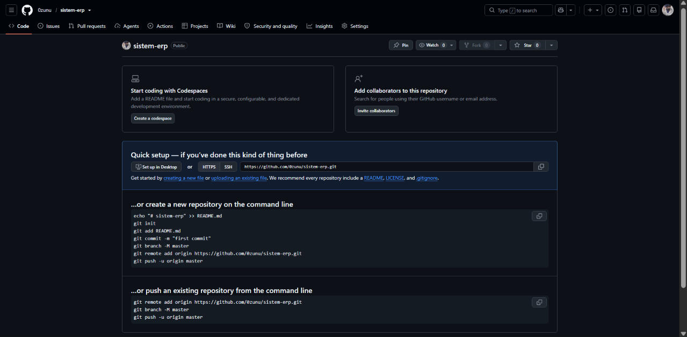

Pada tulisan ini kita akan belajar bagaimana caranya mengupload (push) project ke Github.

> Bagi yang belum install Git silahkan install terlebih dahulu, untuk tutorialnya silahkan cek [link](https://azriel.id/study/programming/git/how-to-install-git-and-initial-configuration-on-windows/) berikut untuk cara instalasinya.

## Membuat Repository GitHub

- Buka [Github](https://github.com) Lalu ke menu `Repositories` dan klik tombol `New` untuk membuat repository baru.

- Buat nama repository baru. Misal `sistem-erp`. Selanjutnya isi bagian lain jika diperlukan. Jika sudah klik tombol `Create Repository`.

## Inisialisasi Git (git init)

Kita perlu melakukan melakukan inisialisasi git di local.

Silahkan buka folder project yang ingin diinisiasi git. Contoh di bawah ini ingin diinisialisasi pada project blog codeigniter.

Buka terminal di project tersebut:

- Windows: klik kanan — pilih `Git Bash Here`

- Linux: klik kanan — pilih `open terminal here`. Atau bisa berpindah ke direktori project menggunakan perintah `cd`.

Inisialisasi git dengan menjalankan perintah:

- `git init`

## Menambahkan Perubahan ke Staging Area (git add)

Pada langkah ini, silahkan kerjakan projek, tugas, atau perubahan apapun.

Jika sudah selesai, selanjutnya kita perlu menambahkan perubahan ke staging area.

Kita bisa menambahkan setiap perubahan ke staging area, kemudian melakukan commit pada setiap perubahan (atomic commit). Atau kita bisa menambahkan semua perubahan ke staging area, kemudian langsung melakukan commit.

Buka terminal di project, sama seperti yang dilakukan pada tahapan inisialisasi git (lihat kembali langkahnya pada bagian inisialisasi git).

Kita coba untuk menambahkan semua perubahan ke staging area:

- `git add .`

> Tanda titik di sini artinya ingin menambahkan semua perubahan ke staging area. Tanda titik sama seperti tanda bintang. Tanda bintang berarti seluruh file. Artinya kita ingin menambahkan semua file ke staging area

## Menyimpan Perubahan (git commit)

Setelah kita menambahkan perubahan ke staging area, langkah terakhir adalah menyimpan perubahan. Hal ini sama seperti ketika kita sudah memasukan barang ke lemari, langkah selanjutnya adalah menguncinya atau menutupnya untuk disimpan.

Jika tidak melanjutkan dari tahapan sebelumnya, silahkan buka terminal pada folder project. Langkah yang dilakukan sama seperti di tahapan inisialisasi git.

Menyimpan perubahan:

- `git commit -m “pesan commit atau perubahan”`

Pada pesan commit, silahkan isi pesan yang mewakili pekerjaan yang dilakukan. Misal menambahkan fitur login, membuat modul tambah data untuk user, menghapus fungsi update, dll.

## Menambahkan Link Remote (git remote)

Kita belum menghubungkan project local dengan repository di github.

Kita akan menambahkan link repository ke project local agar project local dan repository github tersambung.

Buka repository github. Copy link repository (jangan lupa tambahkan `.git` di akhir url). Contoh: `https://github.com/0zunu/sistem-erp.git`

Menambahkan link remote:

- `git remote add origin https://github.com/0zunu/sistem-erp.git`

Kita menambahkan remote dengan nama `origin`, link-nya adalah `https://github.com/0zunu/sistem-erp.git`

## Mengirim Perubahan ke Repository Github (git push)

Langkah terakhir adalah mengirim (upload/push) perubahan ke repository github.

Pada tahapan ini, kita akan mengirimkan kode project yang ada di local (laptop atau komputer) ke online yang ada di repository github.

Mengirim perubahan ke Repository Github:

- `git push origin main`

Kita ingin mengirim perubahan ke `origin` (nama remote yang sudah kita buat pada tahapan sebelumnya) di branch `main` (utama).

Jika terdapat error karena branch `main`, silahkan push ke branch `master`:

- `git push origin master`

Selanjutnya silahkan refresh repository github, dan project yang ada di local sudah terupload ke repository github.

Selesai, terima kasih.
